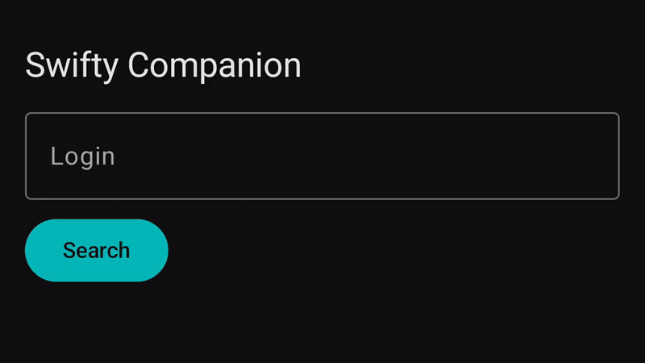

# Swifty Companion

An Android app to look up any 42 student by login and browse their intra profile: level, skills and projects. Built for the 42 *Swifty Companion* project, with Kotlin and Jetpack Compose.



*Profiles shown: my own and `norminet`, a 42 test account. The email is blurred.*

## Features

- **Search** a student by login, with clear errors for an empty field, an unknown login, no network or invalid API credentials.
- **Profile** with photo, full name, coalition (cover and color), email, phone, location, wallet and evaluation points.
- **Level** in the main cursus (`42cursus`, falling back to the student's other cursus), shown as a progress bar.
- **Skills** with level and percentage, sorted from highest to lowest.
- **Projects**, including failed and in-progress ones, sorted by final mark.
- Light and dark theme, following the system setting.

## Tech stack

| | |
|---|---|
| Language | Kotlin |
| UI | Jetpack Compose, Material 3, Navigation Compose |
| Networking | Retrofit, OkHttp, kotlinx.serialization |
| Images | Coil |
| Architecture | MVVM: ViewModel + `StateFlow` exposing a `UiState` (Idle / Loading / Success / Error) |

## How the 42 API is used

The app authenticates with the [42 API](https://api.intra.42.fr/apidoc) using the OAuth2 **client credentials** flow.

- **One token, reused.** `TokenManager` caches the access token and only requests a new one when it is about to expire (60 s margin), so no token is created per query.
- **Refresh on expiry.** If a request still comes back `401`, `AuthInterceptor` forces a new token and retries once.
- **Rate limit.** The API allows 2 requests per second. On a `429`, `RateLimitInterceptor` waits for `Retry-After` and retries once.

Endpoints used: `GET /v2/users/{login}` and `GET /v2/users/{login}/coalitions`.

## Getting started

### Requirements

- Android Studio, or JDK 17 and the Android SDK (platform 35)
- A device or emulator running Android 9 (API 28) or later
- A 42 API application: create one in your intra settings, under *API*

### Credentials

The credentials stay out of git. Create a `.env` file at the root of the project:

```
API_UID=your_application_uid
API_SECRET=your_application_secret
```

The build reads it and injects the values into `BuildConfig`. `.env` is listed in `.gitignore`.

### Build and run

Open the project in Android Studio and run the `app` configuration, or from the command line:

```sh
./gradlew installDebug
```

## Project structure

```
app/src/main/java/com/fortytwo/swifty/
├── data/
│   ├── auth/          # TokenManager: cached OAuth2 token
│   ├── model/         # API response models
│   ├── network/       # Retrofit services, auth and rate-limit interceptors
│   └── repository/    # IntraRepository: API calls mapped to UiState
└── ui/
    ├── common/        # UiState
    ├── navigation/    # Search -> Profile navigation
    ├── profile/       # Profile screen and ViewModel
    ├── search/        # Search screen and ViewModel
    └── theme/         # Colors, typography
```
